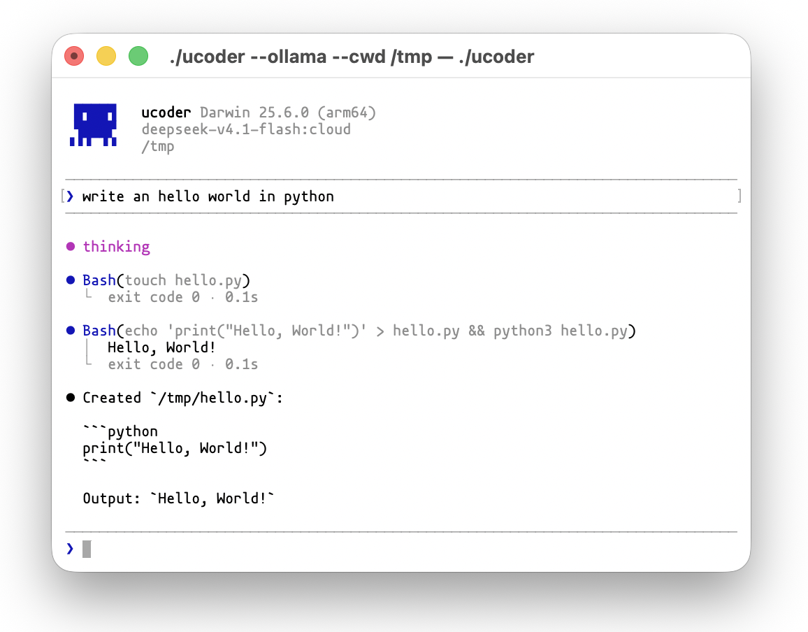

  
 
<strong>ucoder</strong>
 
<em>AI <strong>coding assistant</strong> with a command tool and file editing by line id.</em>
 

 
 

Minimal Claude Code alternative. Single Python file, zero dependencies, ~1200 lines.

## Tools

| Tool | What it does |
|------|--------------|
| `bash` | Run a command (`shell` / `cmd.exe` on Windows), with optional timeout, cwd, or background mode |
| `read` | Read a file, paged with `offset`/`limit`; with `ids=true` each line gets a stable id |
| `replace` | Replace a line or an id range (`7qx2..m04c`) |
| `insert` | Insert before or after a line id |
| `delete` | Delete a line or an id range |
| `memory` | Read and write project notes, stored in `.ucoder/ucoder.db` |

## Keys

| Key | Action |
|-----|--------|
| `Ctrl+C` | Interrupt the running turn; at the prompt, quit (as does `Ctrl+D`) |
| `Ctrl+G` | Open the current input in `$EDITOR` (vim by default); save and quit to send |
| `Ctrl+U` / `Ctrl+K` | Delete to start / end of line |
| `Ctrl+W` | Delete previous word |
| `Ctrl+A` / `Ctrl+E` | Jump to start / end of line |
| `Ctrl+R`, `↑` / `↓` | Search / browse input history, kept per project |
